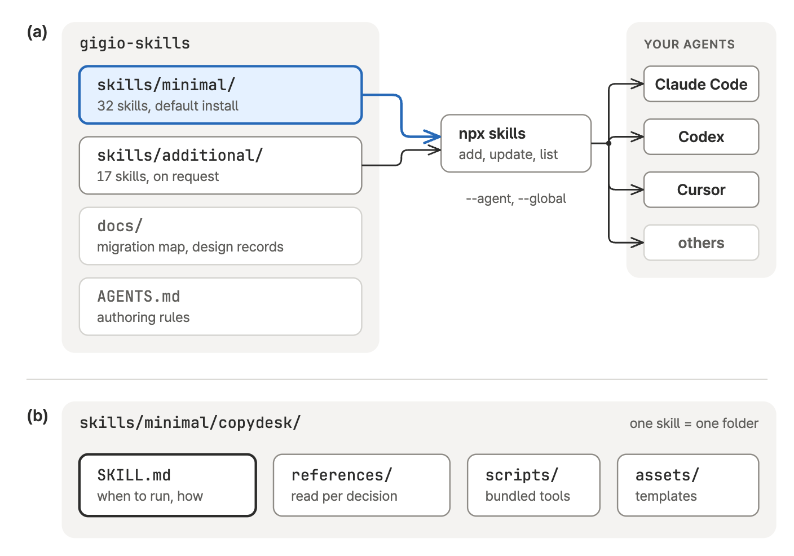
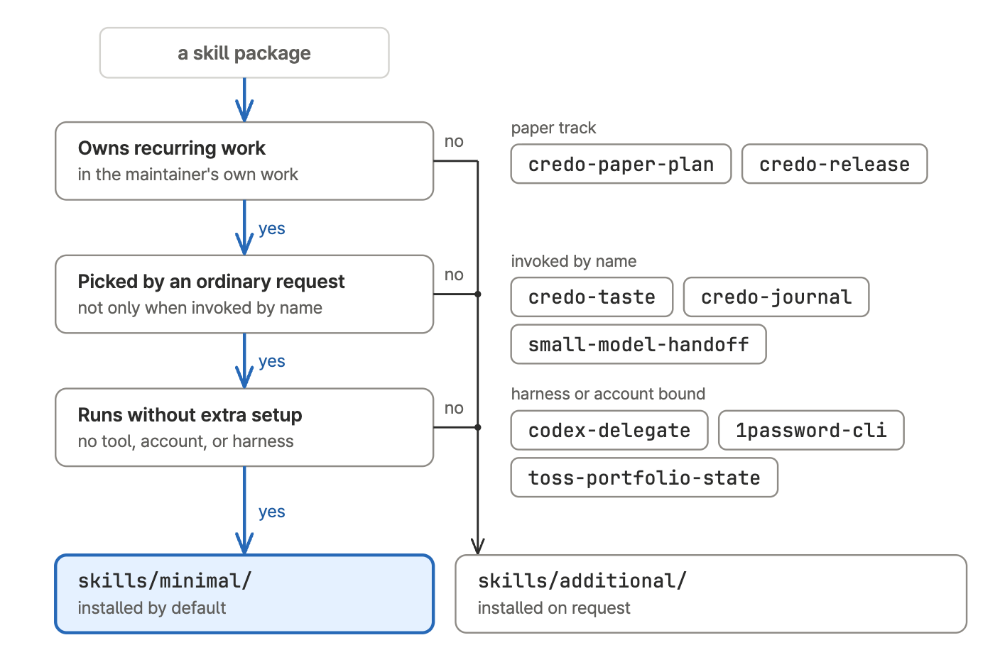
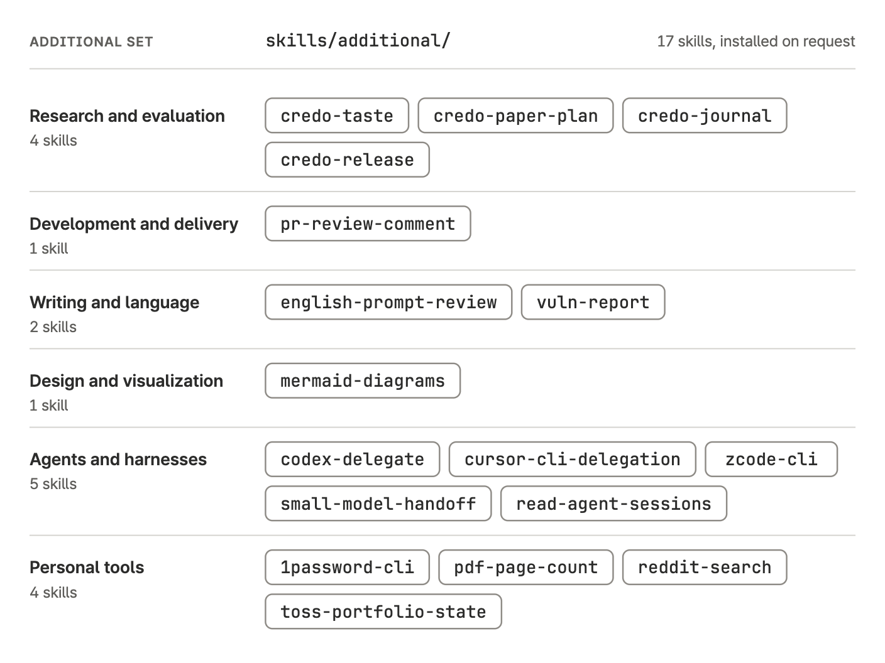

# Gigio Skills

[](https://skills.sh/gigio1023/gigio-skills)

48 reusable [Agent Skills](https://agentskills.io/) for research and evaluation, software delivery, writing, and work with coding agents such as Claude Code, Codex, and Cursor. The skills live in two install sets: the **minimal set** is the default install, and the **additional set** is installed on request. [`npx skills`](https://github.com/vercel-labs/skills) copies the skills you choose into the agents you choose.

<picture>
  <source media="(prefers-color-scheme: dark)" srcset="docs/figures/readme/repo-overview.dark.png">
  
</picture>

A skill is one folder. `SKILL.md` holds the description an agent reads to decide when to run the skill, plus its instructions; `references/`, `scripts/`, and `assets/` are loaded only for the decision that needs them. Each skill works on its own, so an ordinary task does not have to start a project workflow.

[Install sets](#install-sets) · [Install](#install) · [Where to start](#where-to-start) · [Catalog](#skill-catalog) · [Related repositories](#related-repositories) · [Development](#development)

## Install sets

<picture>
  <source media="(prefers-color-scheme: dark)" srcset="docs/figures/readme/install-sets.dark.png">
  
</picture>

- **Minimal set** `skills/minimal/`: 32 skills that cover the maintainer's recurring work. A minimal skill never requires an additional or external skill; it may mention one "when installed".
- **Additional set** `skills/additional/`: 17 skills for the paper track, vulnerability reporting, by-name workflows, harness-specific delegation, and personal tools.
- **A set decides availability only.** Once installed, each skill's description and invocation settings decide when it runs. The minimal set reflects the maintainer's work, so choose sets and skills by your own.

<picture>
  <source media="(prefers-color-scheme: dark)" srcset="docs/figures/readme/minimal-set.dark.png">
  
</picture>

<picture>
  <source media="(prefers-color-scheme: dark)" srcset="docs/figures/readme/additional-set.dark.png">
  
</picture>

## Install

Node.js 22.20 or newer is required by Skills CLI 1.7. Name your agents with `--agent`; the CLI's `--all` targets every skill and every supported agent, which is usually broader than intended.

Install the minimal set:

```bash
npx --yes skills add 'https://github.com/gigio1023/gigio-skills/tree/main/skills/minimal' \
  --skill '*' --agent claude-code codex cursor --global --yes
```

Use `skills/additional` in the same URL for the additional set, or `'gigio1023/gigio-skills#main'` for all 49 skills. Quote the `'*'` so the shell does not expand it.

Install selected skills by name:

```bash
npx --yes skills add 'gigio1023/gigio-skills#main' \
  --skill copydesk work-plan --agent claude-code codex --global --yes
```

Browse the pack, update installed skills, and check what is installed:

```bash
npx --yes skills add 'gigio1023/gigio-skills#main' --list
npx --yes skills update --global --yes
npx --yes skills list --global
```

Omit `--global` for a project-local install. `update` refreshes only skills already tracked; rerun `add` to install new ones. This pack's `frontend-design` shares its name with Anthropic's official `frontend-design` skill: install one of them, or keep both by renaming one through `install-skill-pack`.

## Where to start

An agent picks a skill from its description, so this table is for a person choosing what to install or invoke by name.

| Kind of work | Start with | Then |
| --- | --- | --- |
| Research or product direction | `praxis-direction`; `credo-taste` by name for a paper | `interview`, `design-exploration` |
| Clarify what you want | `interview`; `find-unknowns` for a quick pass | `work-plan`, `design-doc` |
| A system with no design yet | `design-exploration` | `idea-critique`, `design-doc` |
| A chosen concept | `design-doc` | `work-plan`, `coding-standards` |
| Code | `coding-standards` | `review-panel`, `draft-pr`, `commit-and-push` |
| Training or comparing models | `ml-experiment` | `evaluation-design`, `evaluation-operations` |
| Measuring quality | `evaluation-design` | `evaluation-operations`, `evaluation-audit`, `insight-dashboard` |
| Load or a failing system | `load-testing`, `bug-diagnosis` | `design-doc` when the fix changes a design |
| Documents, Notion pages, issues, PRs | `copydesk`, `write-notion`, `write-issue`, `draft-pr` | `review-panel` |
| Delegation, prompts, skills | `orchestrate-subagents`, `model-routing`, `prompting-guide`, `skill-builder` | `codex-delegate`, `small-model-handoff` |
| Continuing or handing off work | `work-plan`, `session-handoff` | `read-agent-sessions` |

## Skill catalog

Grouped by kind of work, in the same order as the figures above. Open a group to see what each skill does.

<details>
<summary><b>Research and evaluation</b>: 10 minimal, 4 additional</summary>

| Skill | Set | Use it to |
| --- | --- | --- |
| [praxis-direction](skills/minimal/praxis-direction/) | minimal | Sharpen an agenda into one bet, run the failure-mode pass on a new system, or set up the praxis profile |
| [design-exploration](skills/minimal/design-exploration/) | minimal | Open the design space for a model- or agent-based system: its root question, mechanisms, and concepts that differ in their bet |
| [idea-critique](skills/minimal/idea-critique/) | minimal | Steelman and attack one idea, then name the measurement that would decide it |
| [design-doc](skills/minimal/design-doc/) | minimal | Write or update a design document with interfaces, a verification split, a decision log, and an experiment queue |
| [literature-research](skills/minimal/literature-research/) | minimal | Read papers for a purpose, check prior art, survey models or datasets, and map mechanisms for a problem |
| [internal-source-research](skills/minimal/internal-source-research/) | minimal | Reconstruct what a team decided from its Notion, Slack, GitHub, or Linear records, read-only and cited |
| [ml-experiment](skills/minimal/ml-experiment/) | minimal | Design, run, or interpret training, adaptation, serving, or reproduction experiments |
| [evaluation-design](skills/minimal/evaluation-design/) | minimal | Design what an eval measures: failure modes, cases, labels, judges, and comparison conditions |
| [evaluation-operations](skills/minimal/evaluation-operations/) | minimal | Operate multi-run evaluation or training campaigns with durable attempt and result records |
| [evaluation-audit](skills/minimal/evaluation-audit/) | minimal | Give a launch, hold, or report verdict on a built eval, judge, harness, or result |
| [credo-taste](skills/additional/credo-taste/) | additional | Choose a research direction or judge whether a result could become a paper; invoked by name |
| [credo-paper-plan](skills/additional/credo-paper-plan/) | additional | Plan a paper's argument, claim-evidence map, prior work, and figures, or a reply to peer reviews |
| [credo-journal](skills/additional/credo-journal/) | additional | Record research ideas, predictions, and hindsight; invoked by name |
| [credo-release](skills/additional/credo-release/) | additional | Check a paper before submission or release |

</details>

<details>
<summary><b>Project continuity</b>: 5 minimal</summary>

| Skill | Set | Use it to |
| --- | --- | --- |
| [find-unknowns](skills/minimal/find-unknowns/) | minimal | Run a quick blind-spot pass for what you have not considered, in any domain |
| [interview](skills/minimal/interview/) | minimal | Answer batched question rounds until the next action is clear |
| [work-plan](skills/minimal/work-plan/) | minimal | Write, execute, or review a plan through the next decision |
| [session-handoff](skills/minimal/session-handoff/) | minimal | Write one file a successor agent executes: state, next actions, and open questions |
| [terminology](skills/minimal/terminology/) | minimal | Apply a project's recorded terms and settle contested names |

</details>

<details>
<summary><b>Development and delivery</b>: 8 minimal, 1 additional</summary>

| Skill | Set | Use it to |
| --- | --- | --- |
| [coding-standards](skills/minimal/coding-standards/) | minimal | Structure, write, verify, and test code in any language, with a Python reference |
| [bug-diagnosis](skills/minimal/bug-diagnosis/) | minimal | Find and verify the root cause of a code or system failure |
| [load-testing](skills/minimal/load-testing/) | minimal | Run and interpret load and capacity tests of a service or model endpoint |
| [review-panel](skills/minimal/review-panel/) | minimal | Review an artifact with separate reviewers from different model families and judge findings by evidence |
| [git-worktree-setup](skills/minimal/git-worktree-setup/) | minimal | Isolate repository work in a worktree while preserving existing changes |
| [commit-and-push](skills/minimal/commit-and-push/) | minimal | Commit and push the requested changes |
| [draft-pr](skills/minimal/draft-pr/) | minimal | Publish, update, or merge a pull request |
| [write-issue](skills/minimal/write-issue/) | minimal | Write and consolidate tracker issues around useful outcomes |
| [pr-review-comment](skills/additional/pr-review-comment/) | additional | Validate review findings against a PR diff and post approved inline comments |

</details>

<details>
<summary><b>Writing and language</b>: 2 minimal, 2 additional</summary>

| Skill | Set | Use it to |
| --- | --- | --- |
| [copydesk](skills/minimal/copydesk/) | minimal | Write, revise, and review documents in natural Korean and precise English; the entry point for any reader-facing text |
| [write-notion](skills/minimal/write-notion/) | minimal | Create and revise team pages in Notion with layout, mentions, tables, and figures |
| [english-prompt-review](skills/additional/english-prompt-review/) | additional | Rewrite an English prompt naturally and explain nuance in your native language |
| [vuln-report](skills/additional/vuln-report/) | additional | Write and check vulnerability reports, advisories, and evidence packages for each disclosure venue |

`copydesk` supplies the shared writing principles that `draft-pr`, `write-issue`, and `write-notion` apply. See its [synthetic examples](skills/minimal/copydesk/references/synthetic-examples.md), [sharing and delivery](skills/minimal/copydesk/references/sharing-and-delivery.md) reference, and the [public writing sources](docs/writing-sources.md).

</details>

<details>
<summary><b>Design and visualization</b>: 2 minimal, 1 additional</summary>

| Skill | Set | Use it to |
| --- | --- | --- |
| [frontend-design](skills/minimal/frontend-design/) | minimal | Build and verify user-visible frontend work, from bug fixes to redesigns |
| [insight-dashboard](skills/minimal/insight-dashboard/) | minimal | Decide what a dashboard compares: metrics, denominators, filters, rankings, and explanatory text |
| [mermaid-diagrams](skills/additional/mermaid-diagrams/) | additional | Write readable, parser-safe Mermaid diagrams and validate their rendering |

</details>

<details>
<summary><b>Agents and harnesses</b>: 5 minimal, 5 additional</summary>

| Skill | Set | Use it to |
| --- | --- | --- |
| [orchestrate-subagents](skills/minimal/orchestrate-subagents/) | minimal | Coordinate delegated work and synthesize its evidence |
| [model-routing](skills/minimal/model-routing/) | minimal | Choose each subagent's model and effort for a Claude Fable or GPT-6 lead |
| [prompting-guide](skills/minimal/prompting-guide/) | minimal | Write, review, and migrate prompts, skills, and goal prompts for Claude Fable, Claude Opus, or GPT-6 |
| [skill-builder](skills/minimal/skill-builder/) | minimal | Turn real workflows into skills, including ones that work across Claude Code and Codex |
| [install-skill-pack](skills/minimal/install-skill-pack/) | minimal | Review and globally install skills from a chosen repository and revision |
| [codex-delegate](skills/additional/codex-delegate/) | additional | Delegate a whole task from a non-Codex host to Codex with durable launch, resume, and handoff |
| [cursor-cli-delegation](skills/additional/cursor-cli-delegation/) | additional | Delegate planning, implementation, or review through Cursor CLI |
| [zcode-cli](skills/additional/zcode-cli/) | additional | Select an available Zcode model and reasoning options, run a task, and resume its session |
| [small-model-handoff](skills/additional/small-model-handoff/) | additional | Package a settled step for a less capable executor; invoked by name |
| [read-agent-sessions](skills/additional/read-agent-sessions/) | additional | Find and read stored Codex, Claude Code, Zcode, or Hermes sessions for another agent |

</details>

<details>
<summary><b>Personal tools</b>: 4 additional</summary>

| Skill | Set | Use it to |
| --- | --- | --- |
| [1password-cli](skills/additional/1password-cli/) | additional | Use the local macOS 1Password CLI for vault, secret, OTP, and environment workflows |
| [pdf-page-count](skills/additional/pdf-page-count/) | additional | Count PDF pages and check page limits |
| [reddit-search](skills/additional/reddit-search/) | additional | Find Reddit threads and read full comment trees through the Arctic Shift archive |
| [toss-portfolio-state](skills/additional/toss-portfolio-state/) | additional | Export a read-only Toss Invest portfolio snapshot |

</details>

## Related repositories

These repositories are versioned on their own and are not installed with this pack. Each README has its install steps.

| Repository | Skills | Adds |
| --- | --- | --- |
| [Gigio Figures](https://github.com/gigio1023/gigio-figures) | `technical-figure`, `eli5-figure`, `drawio-diagram` | Technical figures rendered and linted in light and dark, simple figures on request, and draw.io files |
| [Game Studio](https://github.com/gigio1023/game-studio) | `game-direction`, `game-production`, `game-review` | Direction, production, and review across a game's lifecycle |
| [Godot Best Practice](https://github.com/gigio1023/godot-best-practice) | `godot-best-practice` | Godot implementation and review grounded in the project's engine version |
| [Unity Game Development](https://github.com/gigio1023/unity-game-dev-skill) | `unity-game-dev` | Unity gameplay implementation and review |
| [Astro Dev](https://github.com/gigio1023/astro-dev-skill) | `astro-dev` | Version-aware Astro implementation and migration |

Useful external skills: [kepano/obsidian-skills](https://github.com/kepano/obsidian-skills) for Obsidian vaults, [find-skills](https://github.com/vercel-labs/skills/tree/main/skills/find-skills) for discovering skills, and [shadcn-ui/ui](https://github.com/shadcn-ui/ui/tree/main/skills) for shadcn/ui work. Browse more on [skills.sh](https://skills.sh/) or with `npx --yes skills find`.

## Development

Each bundled skill's source is `skills/<install-set>/<skill-name>/`. [AGENTS.md](AGENTS.md) holds the authoring, set-placement, and validation rules, and [skill-builder](skills/minimal/skill-builder/SKILL.md) guides skill authoring. Keep Markdown prose as natural paragraphs without hard wrapping.

Inspect a checkout without creating a tracked install:

```bash
npx --yes skills add . --list
```

Before publishing, check that each `SKILL.md` name matches its folder, every referenced path exists, the catalog points to the right skill, and the listing finds 48 unique names.

| Topic | Document |
| --- | --- |
| Former names, moves, and merges, including gigio-pack and research-credo absorbed on 2026-10-12 | [docs/migration.md](docs/migration.md) |
| Catalog, source, and installation boundaries | [docs/repo-structure.md](docs/repo-structure.md) |
| Vocabulary decisions | [terminology.md](terminology.md) |
| How `model-routing` divides work with orchestration skills | [docs/routing-skills.md](docs/routing-skills.md) |
| Why `codex-delegate` is designed as it is | [docs/codex-delegate-decision-log.md](docs/codex-delegate-decision-log.md) |
| Writing skill composition and migration | [docs/writing-skills.md](docs/writing-skills.md) |
| Figure sources for this README | [docs/figures/readme/](docs/figures/readme/) |

## License

MIT, see [LICENSE](LICENSE). Files with their own license notice, such as those in `skills/minimal/copydesk/`, keep its terms, and ideas adapted from other projects are credited in each skill's source notes. Prompt clauses quoted from Anthropic's documentation in `skills/minimal/prompting-guide/references/fable/` are marked and linked there; they remain Anthropic's and are not covered by this license.
